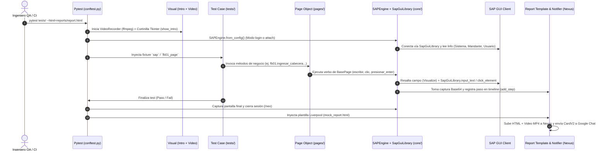

# Guía Completa del Framework de Automatización SAP GUI (`SapGuiLibrary` + POM + Nexus)

Este documento describe de extremo a extremo cómo funciona el framework de automatización para **SAP GUI**, cómo está dividida su lógica bajo el patrón **Page Object Model (POM)** utilizando **`robotframework-sapguilibrary`**, cómo conectar a nuevos ambientes SAP, cómo identificar selectores técnicos y cómo crear tu primer caso de prueba desde cero hasta su publicación en **Nexus** y **Google Chat**.

---

## Tabla de Contenidos
1. [Visión General y Flujo de Ejecución](#1-visión-general-y-flujo-de-ejecución)
2. [División de la Lógica y Responsabilidades (Arquitectura)](#2-división-de-la-lógica-y-responsabilidades-arquitectura)
3. [Cómo Inicializar un Proyecto Nuevo desde Cero](#3-cómo-inicializar-un-proyecto-nuevo-desde-cero)
4. [Cómo Configurar y Realizar una Conexión a SAP](#4-cómo-configurar-y-realizar-una-conexión-a-sap)
5. [Cómo Identificar Selectores Técnicos en SAP GUI](#5-cómo-identificar-selectores-técnicos-en-sap-gui)
6. [Guía Paso a Paso: Cómo Añadir una Nueva Transacción y Caso de Prueba](#6-guía-paso-a-paso-cómo-añadir-una-nueva-transacción-y-caso-de-prueba)
7. [Manejo de Evidencias, Reporte HTML Liverpool y Envío a Nexus](#7-manejo-de-evidencias-reporte-html-liverpool-y-envío-a-nexus)
8. [Referencia Rápida de Métodos de `BasePage`](#8-referencia-rápida-de-métodos-de-basepage)

---

## 1. Visión General y Flujo de Ejecución

El framework combina la potencia de **`pytest`** (para orquestación de pruebas, fixtures y hooks de reportería) con **`robotframework-sapguilibrary`** (`SapGuiLibrary`) como motor de control de SAP GUI y el patrón **Page Object Model (POM)** para mantener las pruebas legibles, modulares y fáciles de mantener.



---

## 2. División de la Lógica y Responsabilidades (Arquitectura)

El código está estrictamente separado en **5 capas** para que ningún archivo mezcle selectores, lógica de bajo nivel de SAP, reglas de negocio o configuración de reportes:

```text
sap_automation_framework/
├── config/                     # 1. CAPA DE CONFIGURACIÓN
│   └── settings.py             # Lee el archivo .env y expone la clase Config
├── core/                       # 2. CAPA DE MOTOR (DRIVER)
│   ├── sap_engine.py           # Wrapper de SapGuiLibrary + Capturas Base64 + Resaltado + Buffers
│   ├── sap_driver.py           # Alias semántico SAPDriver -> SAPEngine
│   └── sheet_runner.py         # Ejecutor opcional de matrices Excel/CSV
├── pages/                      # 3. CAPA PAGE OBJECT MODEL (POM)
│   ├── locators/               # 3.1 Selectores puros separados por transacción
│   │   ├── common_locators.py  # Barra de herramientas, OKCode, Statusbar, Login
│   │   ├── fb01_locators.py    # Selectores de la transacción FB01
│   │   └── fb03_locators.py    # Selectores y rutas de menú de la transacción FB03
│   ├── base_page.py            # 3.2 Superclase con todas las acciones genéricas de SAP
│   ├── login_page.py           # 3.3 Página de inicio de sesión SAP
│   ├── fb01_page.py            # 3.4 Página de negocio de la transacción FB01
│   └── fb03_page.py            # 3.5 Página de negocio y validación de la transacción FB03
├── tests/                      # 4. CAPA DE PRUEBAS (CASOS DE PRUEBA)
│   └── test_fb01_contabilizacion.py
├── utils/                      # 5. CAPA TRANSVERSAL (REPORTES, VIDEO Y NEXUS)
│   ├── report_template.py      # Construcción del HTML interactivo Liverpool
│   ├── visual.py               # Cortinilla previa al test y grabación ffmpeg
│   ├── notifier.py             # API upload a Nexus y Webhook de Google Chat
│   └── logger.py               # Logs en consola y en carpeta logs/
├── data/                       # INSUMOS Y RESULTADOS ESPERADOS
│   ├── expected_result.csv     # Texto de "Resultado Esperado" para cortinilla y reporte
│   └── matriz_fb01.csv         # Datos tabulares de entrada
└── conftest.py                 # Pegamento de Pytest (Fixtures de sesión y hooks de cierre)
```

### ¿Qué va en cada capa?
| Capa | Qué **SÍ** debe contener | Qué **NO** debe contener |
| :--- | :--- | :--- |
| **`pages/locators/`** | Constantes `str` o listas de IDs de SAP (`wnd[0]/usr/ctxt...`) y rutas de menú. | Llamadas a `SapGuiLibrary`, lógica `if/else` o datos de prueba. |
| **`pages/base_page.py`** | Acciones reutilizables para cualquier pantalla (`escribir`, `clic`, `guardar`, `seleccionar_menu`, `obtener_valor`). | IDs específicos de una transacción como `FB01` o `MM01`. |
| **`pages/<tcode>_page.py`** | Métodos de negocio de esa transacción (`completar_cabecera`, `contabilizar_documento`, `validar_documentos`). | Selectores escritos en duro ("hardcoded") o credenciales. |
| **`tests/test_*.py`** | La secuencia funcional del caso de prueba, datos de entrada y aserciones (`assert`). | Llamadas directas a `session.findById(...)` o IDs técnicos de SAP. |
| **`core/sap_engine.py`** | Integración con `SapGuiLibrary`, `win32com`, capturas `ImageGrab`/`HardCopy` y diccionarios de buffers. | Lógica funcional de finanzas, compras o ventas. |

---

## 3. Cómo Inicializar un Proyecto Nuevo desde Cero

Sigue estos pasos cuando clones el repositorio en una máquina nueva o inicies un proyecto para un nuevo módulo de SAP:

### Paso 1: Prerrequisitos en Windows
1. **SAP GUI para Windows** instalado (con tu entrada del servidor dada de alta en **SAP Logon**).
2. **Python 3.10+** instalado y agregado al `PATH`.
3. *(Opcional)* **ffmpeg** en el `PATH` si deseas grabar video `.mp4` de las ejecuciones (`RECORD_VIDEO=true`).

### Paso 2: Habilitar SAP GUI Scripting
Tanto en el cliente local como en el servidor SAP debe estar activo el Scripting:
- **En tu SAP GUI local**:
  1. Abre **SAP Logon** → Haz clic en el ícono de la esquina superior izquierda → **Opciones...** (`Options`).
  2. Ve a **Accesibilidad y Scripting** → **Scripting**.
  3. Marca la casilla **Activar scripting** (`Enable scripting`).
  4. **Desmarca** las casillas *"Notificar cuando un script se conecte a SAP GUI"* y *"Notificar cuando un script abra una conexión"* (para evitar pop-ups de seguridad de Windows que bloqueen el robot).
- **En el servidor SAP** *(si aplica)*:
  - El parámetro de perfil en la transacción `RZ11` (`sapgui/user_scripting`) debe estar en `TRUE`.

### Paso 3: Crear Entorno Virtual e Instalar Dependencias
En PowerShell, dentro de la carpeta raíz del repositorio:

```powershell
# 1. Crear entorno virtual
python -m venv .venv

# 2. Activar entorno virtual
.\.venv\Scripts\Activate.ps1

# 3. Instalar dependencias (incluye robotframework-sapguilibrary, pytest, pywin32, etc.)
pip install -r requirements.txt
```

### Paso 4: Configurar el archivo `.env`
Crea o edita el archivo `.env` en la raíz del proyecto:

```ini
# ── MODO DE CONEXIÓN SAP ('attach' o 'login') ──────────────────
SAP_MODE=attach
SAP_LOGON_PATH=C:\Program Files (x86)\SAP\FrontEnd\SAPgui\saplogon.exe
SAP_SYSTEM=S4H_QAT
SAP_CLIENT=110
SAP_USER=MI_USUARIO_SAP
SAP_PASS=MiPasswordSecreto
SAP_LANGUAGE=ES
SAP_CONNECTION_INDEX=0
SAP_SESSION_INDEX=0

# ── EVIDENCIAS Y COMPORTAMIENTO VISUAL ─────────────────────────
HIGHLIGHT_FIELDS=true
STEP_SCREENSHOTS=true
SHOW_INTRO=true
INTRO_SECONDS=3
RECORD_VIDEO=false

# ── REPORTE LIVERPOOL, NEXUS Y GOOGLE CHAT ─────────────────────
PROJECT_NAME=SAP ECC → S/4HANA
NEXUS_PROJECT=SAP_S4H
NEXUS_BASE_URL=https://nexushub.up.railway.app
NEXUS_API_KEY=tu_api_key_de_nexus
SKIP_NEXUS_UPLOAD=false
AUTO_ACC=https://chat.googleapis.com/v1/spaces/XXX/messages?key=YYY&token=ZZZ
GOOGLE_CHAT_SUBTITLE=SAP Migración ECC to S4H
```

---

## 4. Cómo Configurar y Realizar una Conexión a SAP

El motor [`SAPEngine.from_config()`]
 soporta **dos modos de conexión**, controlados por la variable `SAP_MODE` en `.env`:

### Modo 1: `SAP_MODE=attach` (Recomendado durante desarrollo local)
- **Cómo funciona**: Te conectas manualmente a SAP Logon, inicias sesión una sola vez y dejas la ventana abierta. Cuando ejecutas `pytest`, `SapGuiLibrary.connect_to_session()` se engancha a tu ventana abierta al instante.
- **Ventaja**: No necesitas re-autenticarte en cada prueba mientras estás desarrollando o depurando selectores.
- **Tip**: Si deseas abrir la sesión automáticamente desde consola antes de usar `attach`, puedes ejecutar:
  ```powershell
  python abrir_sap_session.py
  ```

### Modo 2: `SAP_MODE=login` (Recomendado para ejecuciones desatendidas / CI)
- **Cómo funciona**: Si `saplogon.exe` no está abierto, el framework lo inicia automáticamente desde `SAP_LOGON_PATH`, invoca `SapGuiLibrary.open_connection(SAP_SYSTEM)` usando el **nombre exacto** de la conexión en tu SAP Logon Pad, ingresa Mandante, Usuario, Contraseña e Idioma y al finalizar el test cierra la sesión con `/nex`.
- **Importante**: `SAP_SYSTEM` debe coincidir carácter por carácter con la columna **Nombre (Name)** o **Descripción** que aparece en tu lista de conexiones de SAP Logon.

### ¿Cómo conectarse a una segunda ventana o conexión simultánea?
Si tienes más de una conexión o sesión abierta, puedes indicarle en `.env`:
```ini
SAP_CONNECTION_INDEX=0   # Primera conexión abierta en SAP Logon
SAP_SESSION_INDEX=1      # Segunda ventana (sesión) de esa conexión
```
O instanciarlo explícitamente en Python:
```python
from core.sap_engine import SAPEngine
sap_secundario = SAPEngine(connection_index=0, session_index=1)
```

---

## 5. Cómo Identificar Selectores Técnicos en SAP GUI

En SAP GUI todos los elementos tienen un **ID jerárquico COM** que comienza por la ventana (`wnd[0]` para la ventana principal, `wnd[1]` para pop-ups modales).

Ejemplo de anatomía de un selector SAP:
```text
wnd[0]/usr/ctxtBKPF-BUKRS
 │      │   │   └─ Nombre técnico de la tabla-campo ABAP (BKPF-BUKRS = Sociedad)
 │      │   └───── Tipo de control (ctxt = Combo/Text con F4, txt = TextField, btn = Botón, rad = Radio, chk = Checkbox)
 │      └───────── Área de usuario de la pantalla (usr), o barra de herramientas (tbar[0], tbar[1]), menú (mbar), estado (sbar)
 └──────────────── Ventana principal (0)
```

### Método A: Grabadora Nativa de SAP GUI (Sin instalar herramientas externas)
1. En la ventana de SAP GUI, haz clic en el ícono de **Ajustar disposición local** (el engranaje o monitor multicolor en la barra superior, o presiona `Alt + F12`).
2. Selecciona **Grabación y reproducción de script...** (`Script Recording and Playback...`).
3. Haz clic en el botón **Grabar script** (círculo rojo) y realiza manualmente en SAP los pasos de tu prueba (escribir en campos, presionar botones, abrir menús).
4. Detén la grabación y abre el archivo `.vbs` generado con cualquier editor de texto.
5. Verás líneas como:
   ```vbscript
   session.findById("wnd[0]/usr/ctxtBKPF-BLDAT").text = "14.10.2026"
   session.findById("wnd[0]/tbar[1]/btn[14]").press
   ```
6. Copia únicamente el string dentro de `findById("...")` y llévalo a tu archivo de localizadores en `pages/locators/`.

### Método B: Scripting Tracker (Inspector visual estilo DevTools)
1. Abre la herramienta gratuita **SAP Scripting Tracker** (de Stefan Schnell) mientras SAP GUI está abierto.
2. En la pestaña **Analyzer**, haz clic en el botón de mira (Crosshair) y arrástralo sobre cualquier campo, tabla o botón de SAP GUI.
3. Copia la propiedad **ID** a partir de `wnd[0]/...` (ignorando el prefijo `/app/con[0]/ses[0]/`).

### Caso Especial: Subscreens Dinámicos (Ej. Bloque de Imputación `SAPLKACB`)
En algunas transacciones de SAP (como `FB01`, `ME21N` o `VA01`), el número de contenedor `subBLOCK` cambia según la sociedad o cuenta contable (por ejemplo: `wnd[0]/usr/subBLOCK:SAPLKACB:1006/ctxtCOBL-KOSTL` vs `1002`).
- **Solución en este framework**: Declara una lista de posibles IDs en tu archivo de localizadores y usa `self.escribir_en_id_dinamico(LISTA_IDS, valor, etiqueta)` desde tu Page Object. Si ninguno de los IDs exactos coincide, el framework buscará automáticamente en todo el árbol de la pantalla el campo cuyo nombre técnico termine en `COBL-KOSTL`.

---

## 6. Guía Paso a Paso: Cómo Añadir una Nueva Transacción y Caso de Prueba

Supongamos que quieres automatizar una nueva transacción, por ejemplo **`MM03` (Visualizar Material)** o un nuevo flujo de **`FB01`**. Sigue estos **4 pasos**:

### Paso 1: Crear los Localizadores en `pages/locators/`
Crea el archivo `pages/locators/mm03_locators.py` (o agrega los controles al archivo existente de la transacción):

```python
# pages/locators/mm03_locators.py
class MM03Locators:
    """IDs de controles SAP GUI para la transacción MM03 (Visualizar Material)."""

    TCODE = "MM03"
    TXT_MATERIAL = "wnd[0]/usr/ctxtRMMG1-MATNR"
    BTN_SELECCION_VISTAS = "wnd[0]/tbar[1]/btn[5]"
    POPUP_VISTAS_TABLA = "wnd[1]/usr/tblSAPLMGMMTC_VIEW"
    TXT_DESCRIPCION_MATERIAL = "wnd[0]/usr/txtMAKT-MAKTX"
```
*(Y expórtalo en [`pages/locators/__init__.py`](file:///c:/Users/JIBARAJASM/.gemini/antigravity/scratch/sap_automation_framework/pages/locators/__init__.py)).*

---

### Paso 2: Crear el Page Object en `pages/`
Crea el archivo `pages/mm03_page.py` heredando de [`BasePage`](file:///c:/Users/JIBARAJASM/.gemini/antigravity/scratch/sap_automation_framework/pages/base_page.py):

```python
# pages/mm03_page.py
from pages.base_page import BasePage
from pages.locators.mm03_locators import MM03Locators


class MM03Page(BasePage):
    """Page Object para la transacción MM03 (Visualización de Materiales)."""

    def abrir(self) -> "MM03Page":
        self.abrir_transaccion(MM03Locators.TCODE)
        return self

    def buscar_material(self, codigo_material: str) -> "MM03Page":
        self.escribir(MM03Locators.TXT_MATERIAL, codigo_material, "Código de Material")
        self.presionar_enter("Confirmar código de material")
        return self

    def seleccionar_primera_vista(self) -> "MM03Page":
        self.seleccionar_fila_tabla(MM03Locators.POPUP_VISTAS_TABLA, fila=0, etiqueta="Vista Datos Básicos 1")
        self.enviar_vkey(0, ventana="wnd[1]", descripcion="Confirmar selección de vistas")
        return self

    def validar_descripcion_material(self, texto_esperado: str) -> str:
        self.verificar_elemento_contiene(
            MM03Locators.TXT_DESCRIPCION_MATERIAL,
            texto_esperado,
            mensaje=f"La descripción del material no contiene '{texto_esperado}'",
        )
        descripcion_actual = self.obtener_valor(MM03Locators.TXT_DESCRIPCION_MATERIAL)
        self.guardar_buffer("DescripcionMaterial", descripcion_actual)
        return descripcion_actual
```

---

### Paso 3: Registrar el Resultado Esperado en `data/expected_result.csv`
Para que la **cortinilla de video** y el recuadro morado de **Resultado Esperado** aparezcan en el reporte HTML de Liverpool, agrega una fila en [`data/expected_result.csv`] donde `test_id` coincida con parte del nombre de tu función de test (por ejemplo `MM03_001`):

```csv
test_id,resultado_esperado
FB01_001,El documento contable se contabiliza exitosamente en FB01 generando un número de documento en la barra de estado y mostrándose en FB03.
MM03_001,El sistema muestra la vista de Datos Básicos 1 del material y valida su descripción comercial sin errores.
```

---

### Paso 4: Crear el Archivo de Prueba en `tests/`
Crea el archivo `tests/test_mm03_visualizacion.py`:

```python
# tests/test_mm03_visualizacion.py
from pages.mm03_page import MM03Page


def test_MM03_001_validar_datos_basicos_material(sap):
    """
    TC_MM03_001: Consulta de material en MM03 y validación de su descripción en Datos Básicos 1.
    """
    mm03 = MM03Page(sap)

    mm03.abrir()
    mm03.buscar_material(codigo_material="10004589")
    mm03.seleccionar_primera_vista()

    descripcion = mm03.validar_descripcion_material(texto_esperado="ARTICULO PRUEBA")
    assert descripcion, "La descripción del material no debe estar vacía."
```

---

## 7. Manejo de Evidencias, Reporte HTML Liverpool y Envío a Nexus

Todo el ciclo de evidencias y reportería ocurre de manera **automática** a través de [`conftest.py`], [`utils/report_template.py`] y [`utils/notifier.py`]:

### 7.1. ¿Cómo se toman las evidencias durante el test?
1. **Evidencia automática por paso**: Cada vez que un Page Object llama a `self.escribir(...)`, `self.clic(...)`, `self.guardar(...)`, etc., el motor:
   - Dibuja un marco rojo alrededor del control en SAP GUI si `HIGHLIGHT_FIELDS=true`.
   - Si `STEP_SCREENSHOTS=true` en `.env`, toma una captura instantánea en Base64 de la ventana de SAP (o del escritorio completo si hay una ventana emergente `wnd[1]`) y la incrusta en el paso correspondiente dentro del reporte HTML.
2. **Evidencia obligatoria de Pantalla Final**: Aunque `STEP_SCREENSHOTS=false`, al terminar cada caso de prueba (`pytest_runtest_makereport`), el framework captura siempre la **Pantalla Final** del caso (sea exitoso o fallido).
3. **Evidencia manual en disco**: Si en un punto específico necesitas guardar un archivo `.png` suelto en `reports/`, llama a `self.tomar_evidencia("Nombre_Del_Paso")` desde tu Page Object.
4. **Grabación de Video de toda la suite**: Si `RECORD_VIDEO=true` y ejecutas `pytest` con `--html=...`, [`VideoRecorder`](file:///c:/Users/JIBARAJASM/.gemini/antigravity/scratch/sap_automation_framework/utils/visual.py#L62-L94) graba en `.mp4` todo el escritorio (incluyendo la cortinilla inicial de cada test con su resultado esperado).

### 7.2. Comandos de Ejecución y Publicación a Nexus

- **Ejecución de desarrollo (rápida en consola, sin subir a Nexus):**
  ```powershell
  pytest tests/test_fb01_contabilizacion.py -v -s
  ```
- **Ejecución completa generando Reporte HTML Liverpool + Subida a Nexus + Google Chat:**
  ```powershell
  pytest tests/test_fb01_contabilizacion.py --html=reports/report.html --self-contained-html -v -s
  ```
  > Al pasar `--html=reports/report.html`, [`conftest.py`] renombra automáticamente el archivo agregándole fecha y hora (`reports/report_YYYY-MM-DD_HH-MM-SS.html`), le inyecta el diseño interactivo de Liverpool, y al finalizar la suite lo sube a **Nexus** (`POST /api/reports/upload` y `POST /api/videos/upload`) y envía la tarjeta **CardV2** al webhook `AUTO_ACC` de Google Chat.
- **Generar el reporte HTML localmente SIN subirlo a Nexus:**
  Configura `SKIP_NEXUS_UPLOAD=true` en tu archivo `.env` antes de correr el comando `--html`.

---

## 8. Referencia Rápida de Métodos de `BasePage`

Todos tus Page Objects en `pages/` heredan de [`BasePage`] y tienen disponibles los siguientes métodos (todos respaldados internamente por `SapGuiLibrary`):

| Categoría | Método en `BasePage` | Keyword de `SapGuiLibrary` subyacente | Descripción |
| :--- | :--- | :--- | :--- |
| **Navegación** | `self.abrir_transaccion("FB01")` | `run_transaction("/nFB01")` | Ejecuta una transacción o comando en el OKCode. |
| **Navegación** | `self.presionar_enter("Descripción")` | `send_vkey(0, window=0)` | Envía Enter a la ventana principal y registra el paso. |
| **Navegación** | `self.guardar("Descripción")` | `click_element("wnd[0]/tbar[0]/btn[11]")` | Presiona el botón Guardar / Contabilizar de SAP. |
| **Navegación** | `self.enviar_vkey(12, ventana="wnd[1]")` | `send_vkey(12, window=1)` | Envía cualquier tecla virtual (0=Enter, 3=F3, 8=F8, 12=F12/ESC). |
| **Navegación** | `self.seleccionar_menu("Documento->Visualizar")` | `click_element(menu_id)` | Navega por la barra de menús superior usando textos visibles. |
| **Inputs** | `self.escribir(locator, valor, etiqueta)` | `input_text(locator, valor)` | Escribe texto, resalta el campo y toma captura para el reporte. |
| **Inputs** | `self.escribir_password(locator, pwd)` | `input_password(locator, pwd)` | Escribe contraseña enmascarando `********` en logs y reporte. |
| **Inputs** | `self.escribir_en_id_dinamico(lista_ids, valor, etiqueta)` | `element_should_be_present` + `input_text` | Resuelve subscreens variables y escribe en el control encontrado. |
| **Clicks / Controles** | `self.clic(locator, etiqueta)` | `click_element(locator)` | Hace clic en un botón, pestaña (`GuiTab`) o menú. |
| **Clicks / Controles** | `self.marcar_checkbox(locator, seleccionado=True)` | `select_checkbox` / `unselect_checkbox` | Marca o desmarca una casilla de verificación. |
| **Clicks / Controles** | `self.seleccionar_radio_button(locator)` | `select_radio_button(locator)` | Selecciona un botón de opción (`GuiRadioButton`). |
| **Clicks / Controles** | `self.seleccionar_combo(locator, valor)` | `select_from_list_by_label(locator, valor)` | Selecciona un elemento de una lista desplegable (`GuiComboBox`). |
| **Tablas (GridView)** | `self.obtener_valor_celda(tabla, fila, col_id)` | `get_cell_value(tabla, fila, col_id)` | Lee el valor de una celda en una tabla ALV / GridView. |
| **Tablas (GridView)** | `self.escribir_en_celda(tabla, fila, col_id, valor)` | `set_cell_value(tabla, fila, col_id, valor)` | Modifica una celda en una tabla ALV / GridView. |
| **Tablas (GridView)** | `self.seleccionar_fila_tabla(tabla, fila)` | `select_table_row(tabla, fila)` | Selecciona la fila completa (índice base 0). |
| **Tablas (GridView)** | `self.clic_boton_tabla(tabla, boton_id)` | `click_toolbar_button(tabla, boton_id)` | Presiona un botón propio de la barra de una tabla ALV. |
| **Validaciones** | `self.verificar_elemento_presente(locator)` | `element_should_be_present(locator)` | Falla la prueba si el control no existe en la pantalla. |
| **Validaciones** | `self.verificar_valor_elemento(locator, esperado)` | `element_value_should_be(locator, esperado)` | Valida que el valor del control sea exactamente `esperado`. |
| **Validaciones** | `self.verificar_elemento_contiene(locator, texto)` | `element_value_should_contain(locator, texto)` | Valida que el texto del control contenga la subcadena `texto`. |
| **Statusbar / Buffers** | `self.capturar_documento_de_barra_estado("NumDoc")` | `get_value("wnd[0]/sbar")` | Valida la barra de estado, extrae el Nº de documento y lo guarda en buffer. |
| **Statusbar / Buffers** | `self.guardar_buffer(k, v)` / `self.obtener_buffer(k)` | Diccionario `sap.buffers` | Comparte datos dinámicos (números de pedido, pólizas, etc.) entre páginas. |

